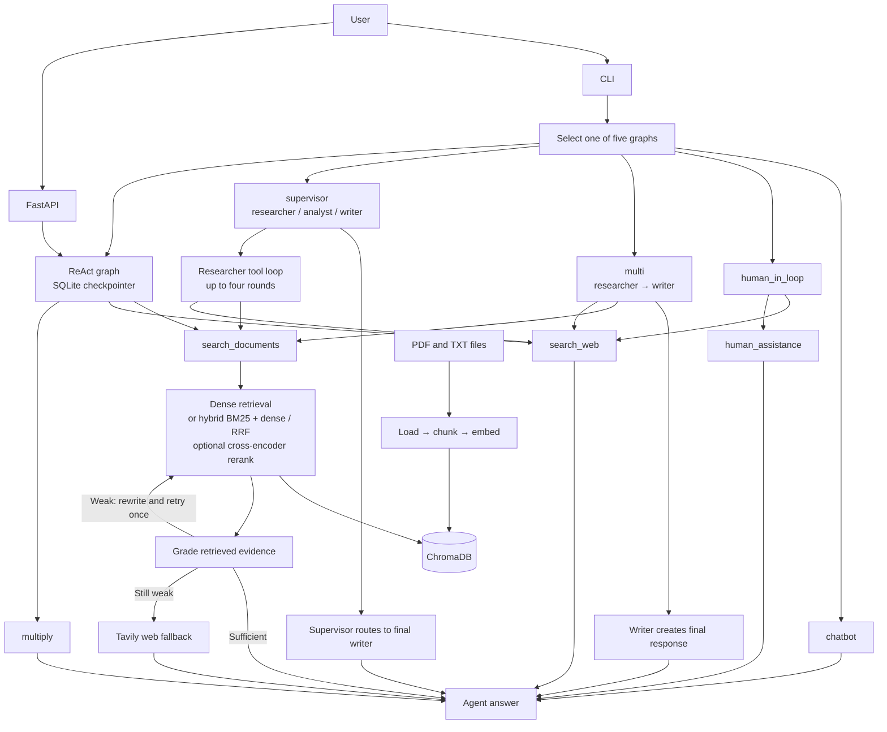

# Nexus-Agent: an agentic RAG system built with LangGraph

A research assistant that can answer from an indexed document collection, search the web, or call other tools. The repository includes five LangGraph agent modes, a retrieval pipeline with optional hybrid search and reranking, and a streaming HTTP API.

> **Status:** Core agent, retrieval, API, and deployment paths are implemented. The roadmap below tracks remaining work.

## Architecture



The CLI can select `react`, `chatbot`, `human_in_loop`, `multi` (researcher then writer), or `supervisor` (supervisor routes among researcher, analyst, and writer). The FastAPI endpoints currently expose the ReAct graph. CLI graph state is in memory; API conversation state is persisted in SQLite by `thread_id`.

## What is implemented

- **Agent modes and tool use:** the ReAct and multi-agent researcher graphs can call tools; the supervisor's researcher can call tools for up to four rounds. The other graphs provide a basic chatbot and a human-assistance interrupt workflow.
- **Document ingestion and RAG** (`src/rag/`): recursive PDF/TXT loading and chunking (1000 characters with 200 overlap), `all-MiniLM-L6-v2` embeddings, ChromaDB upserts with stale-chunk cleanup, and source/page metadata.
- **Retrieval modes:** dense is the default; `hybrid` combines BM25 and dense rankings with Reciprocal Rank Fusion, and `hybrid_rerank` reranks fused candidates with a cross-encoder.
- **Agentic document retrieval:** retrieved passages are graded for relevance; weak evidence triggers a rewritten-query retry, then Tavily web fallback if still weak.
- **API and persistence:** FastAPI `/chat`, `/chat/stream` (SSE), and `/health` endpoints; SQLite-backed graph checkpoints; optional bearer-token protection.
- **Observability:** opt-in LangSmith tracing and trace reports for latency, tokens, and cost.
- **Containerization:** Dockerfile and Docker Compose configuration for the API.
- **Tests:** pytest tests are under `Tests/`.

## Quick start (Windows PowerShell)

```powershell
git clone https://github.com/Shivzm/Basic-Chatbot.git
cd Basic-Chatbot
uv sync

copy .env.example .env        # then put your GROQ_API_KEY and TAVILY_API_KEY in .env

# 1. Get documents into data/docs/ (your own PDFs/.txt files, or the sample corpus:)
uv run python -m src.scripts.download_corpus

# 2. build the vector database (creates data/chroma/)
uv run python -m src.scripts.ingest

# 3. chat with an agent
uv run python main.py --agent react
uv run python main.py --agent supervisor
```

The first ingest downloads the embedding model. Run the tests with `uv run pytest`.

## Project layout

```
api/                      FastAPI app and SQLite-backed chat API
config/                   settings and .env loading
src/agents/               five LangGraph agent graphs
src/rag/                  ingestion, Chroma store, retrieval, reranker, grading/retry
src/scripts/              corpus download and ingestion commands
tools/                    document/web search, math, human assistance, summary
evals/                    draft question-set generator
Tests/                    pytest suite
data/docs/                local PDF/TXT corpus (not committed)
data/chroma/              generated vector index (not committed)
data/api_checkpoints.sqlite  persistent API conversation checkpoints (generated)
Dockerfile / docker-compose.yml  containerized API deployment
```

## Issue write-up

The Groq request-size issue, investigation, and implemented conversation-history compaction are documented in [ISSUES_AND_SOLUTIONS.md](./ISSUES_AND_SOLUTIONS.md).

## Results

Measured on a fixed, hand-reviewed question set over the corpus in `data/docs/`. Each row changes one thing.

| Configuration | hit@5 | MRR | Faithfulness | Context recall | p95 latency |
|---|---|---|---|---|---|
| Dense retrieval (baseline) | – | – | – | – | – |
| + BM25 hybrid (RRF) | – | – | – | – | – |
| + Cross-encoder reranker | – | – | – | – | – |
| + Query rewriting and retry | – | – | – | – | – |

The reviewed evaluation set is in `evals/reviewed_dataset.jsonl`, and excluded or duplicate cases are tracked in `evals/excluded_rows.jsonl`. The results table stays blank until benchmark scores are generated from this reviewed set.

## Building the evaluation question set

Generate draft questions from a reproducibly sampled set of corpus chunks:

```powershell
uv run python -m evals.build_dataset --count 30 --seed 42 --output evals/dataset.jsonl
```

The generator uses the configured default model and writes JSONL with each question, a draft ground-truth answer, source file/page, and reference context. Generation requires the configured model API key. Groq token-per-minute limits can pause generation; the script retries rate-limited requests with backoff (8 retries by default, configurable with `--max-retries`). Treat every row as a draft; review and correct the dataset before using it for metrics or changing retrieval settings. The retrieval score cutoff (`rag_score_threshold`, default `0.5`) is an initial heuristic and should be calibrated against this reviewed set.

Review each generated row:

- [ ] Is the question clear, self-contained, and answerable from its cited reference context alone?
- [ ] Is the ground-truth answer factually correct, complete enough, and supported by that context?
- [ ] Does the source file and page identify the evidence accurately?
- [ ] Is the question distinct from the other rows, and does the set cover different documents and topics?
- [ ] Is this an appropriate retrieval question (not dependent on current events, outside knowledge, or arithmetic)?
- [ ] Keep, edit, or discard the row; only accepted, human-reviewed rows belong in the evaluation set.

## Running the local baseline evaluation

Save accepted questions as `evals/reviewed_dataset.jsonl`, then run:

```powershell
uv run python -m evals.run_eval --count 30 --max-workers 1 --max-retries 8
```

The runner uses the existing LangSmith SDK locally (`upload_results=False`), so evaluation inputs and results are not uploaded to LangSmith. Groq still receives the answer-generation and judge prompts. Evaluation concurrency is fixed to one worker; rate-limited Groq calls retry with backoff. The score sheet includes document-level hit@5/MRR and custom LLM-judge estimates for faithfulness, context recall, and context precision. These judge scores are not Ragas metric implementations.

Run the separate Ragas baseline in its own project environment. It uses the same reviewed questions, dense retriever, answer model, and top-5 cutoff, then reports hit@5, MRR, Ragas faithfulness, context recall, and context precision:

```powershell
$env:UV_PROJECT_ENVIRONMENT = ".venv-eval"
uv sync --group ragas --no-dev
uv run --group ragas python -m evals.run_ragas_eval --count 30 --max-retries 8
```

Set `EVAL_MODEL` to override the default `openai/gpt-oss-20b`; `GROQ_API_KEY` must be available through `.env` or the environment. The runner writes aggregate JSON and per-question CSV files under `evals/results/`. Ragas sends prompts, retrieved passages, answers, and references to the configured model provider for judging. The local `data/chroma/` index must already contain the corpus; the runner does not ingest documents. Ragas metric values are model-judged estimates and are not directly interchangeable with scores from the custom LangSmith baseline.

Compare dense and hybrid retrieval against the same reviewed set:

```powershell
uv run python -m evals.run_eval --config dense --count 30 --max-workers 1
uv run python -m evals.run_eval --config hybrid --count 30 --max-workers 1
```

The hybrid configuration builds a cached BM25 index from the chunks in Chroma and fuses its ranking with dense retrieval using RRF. Re-run ingestion after changing documents; ingestion invalidates the in-process lexical index.

Compare hybrid retrieval with and without cross-encoder reranking:

```powershell
uv run python -m evals.run_eval --config hybrid --count 30 --max-workers 1
uv run python -m evals.run_eval --config hybrid_rerank --count 30 --max-workers 1
```

`hybrid_rerank` reranks up to `rag_reranker_candidate_k` (20 by default) RRF candidates using `rag_reranker_model` (`cross-encoder/ms-marco-MiniLM-L-6-v2`). The model is downloaded on first use; set `RAG_RERANKER_MODEL` or `RAG_RERANKER_CANDIDATE_K` to override the defaults. Both configurations use the same reviewed set and answer/judge models for a fair comparison.

Document-tool calls now grade retrieved passages, retry once with a rewritten query when evidence is weak, and use web search if the retry is still weak. Set `RAG_AGENTIC_MAX_REWRITES` to change the retry limit (default: `1`). The web fallback is clearly labelled in the tool result.

## Evaluating agent tool selection

`evals/agent_dataset.jsonl` contains labeled document, web, and arithmetic questions. Run the ReAct agent and its task-success judge against this set:

```powershell
uv run python -m evals.run_agent_eval
```

The report includes first-tool selection accuracy and LLM-judged end-to-end task-success rate, overall and by category, plus per-question CSV/JSON details. The judge scores answer quality independently of whether the agent chose the expected tool. Use `--model groq:openai/gpt-oss-20b` or `AGENT_EVAL_MODEL` to select the model. This small, manually labeled set is a smoke benchmark; review its cases and judge explanations before drawing broad conclusions.

The initial nine-case run reported 66.7% first-tool accuracy and 100% LLM-judged task success. This was before the routing-prompt and freshness-rubric improvements in the current code; the follow-up run hit Groq's daily token limit, so these numbers are a preliminary baseline, not a result for the current prompt.

## LangSmith tracing and observability

Tracing is opt-in. Set `LANGSMITH_TRACING=true`, `LANGSMITH_API_KEY`, and `LANGSMITH_PROJECT=nexus-agent` in `.env`, then run normal agent queries or `uv run python -m evals.run_agent_eval` to create traces. **Traces can contain user prompts, model outputs, and tool results; only enable tracing for data you are permitted to send to LangSmith.**

Report recent per-query and per-node latency and token usage:

```powershell
uv run python -m evals.report_traces --project nexus-agent --hours 24
```

The script writes JSON and CSV reports under `evals/results/`. It uses provider-reported LangSmith costs when available. If traces have no cost fields, pass both `--input-usd-per-million` and `--output-usd-per-million` to estimate model cost from token usage using your provider's current rates; cost is marked unavailable otherwise. The report's cost coverage shows which model calls had a cost. Run `uv run python -m evals.report_traces --help` for filters and options.

## API and Docker

The FastAPI service exposes `/chat` for JSON responses, `/chat/stream` for server-sent events, and `/health` for liveness checks. Responses include document sources as `{source, page}` records. Conversation state is persisted in SQLite using the request's `thread_id`.

```powershell
copy .env.example .env   # set GROQ_API_KEY and TAVILY_API_KEY
# put your corpus under data/docs/ and ingest it first
docker compose up --build
```

The Compose setup binds to `127.0.0.1:8000` and mounts `data/`, which persists both `data/chroma/` and `data/api_checkpoints.sqlite`. Test a streaming response with:

```powershell
curl.exe -N -X POST http://127.0.0.1:8000/chat/stream `
  -H "Content-Type: application/json" `
  -d "{\"thread_id\":\"demo\",\"question\":\"Summarize my documents about RAG.\"}"
```

For any non-local deployment, set `API_BEARER_TOKEN` in `.env`, use HTTPS behind a trusted reverse proxy, and restrict access to the SQLite and Chroma data. Traces and request data may contain sensitive content; keep LangSmith tracing disabled unless that data may be sent there.

## Roadmap

- [x] RAG pipeline on ChromaDB
- [x] RAG tool wired into the agents, with tool loops in the multi-agent graphs
- [x] Hand-reviewed evaluation set
- [ ] Separate Ragas baseline (a custom local LangSmith baseline exists)
- [x] Hybrid search (BM25 + dense, RRF)
- [ ] Cross-encoder reranking benchmark (implementation available as `hybrid_rerank`)
- [x] Agentic retrieval: grade context, rewrite query, retry or fall back to web search
- [x] Agent-level tool-selection and task-success evaluation
- [x] Opt-in LangSmith tracing and latency/token/cost reports by query and node
- [x] FastAPI service, Docker, persistent SQLite checkpointer
- [ ] Semantic cache and load test
- [ ] CI check that fails when retrieval quality drops

## Tech stack

Python 3.13 (project supports Python 3.11–3.13), LangGraph, LangChain, Groq (`openai/gpt-oss-20b` / `openai/gpt-oss-120b` defaults), FastAPI, Uvicorn, SQLite checkpointer, ChromaDB, sentence-transformers (`all-MiniLM-L6-v2` embeddings and an MS MARCO cross-encoder reranker), BM25 (`rank-bm25`), PyMuPDF, Tavily, LangSmith, pytest, and uv. Ragas is an optional dependency group for the isolated evaluation environment; Docker is used for API packaging.
