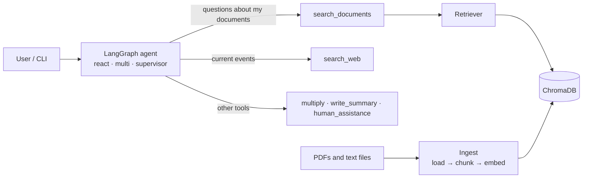

# Nexus-Agent: an agentic RAG system built with LangGraph

A multi-agent assistant that decides whether to answer from **your own documents** (retrieval over ChromaDB), from **the live web**, or by using other tools, and cites where its answer came from. It combines five LangGraph agent architectures with a document-retrieval pipeline.

> **Status:** work in progress. The retrieval pipeline and agent wiring are in place; evaluation, hybrid search and observability are being added step by step. The results table below stays empty until each number comes from a real run (see `evals/results/`).

## Architecture



## What is implemented

- **Five agent modes** (`--agent`): `react`, `chatbot`, `human_in_loop`, `multi` (researcher → writer), `supervisor` (supervisor → researcher / analyst / writer).
- **Tool loops:** the researcher in `multi` and `supervisor` calls tools (`search_documents`, `search_web`) before writing; the supervisor loop is capped at 4 rounds.
- **RAG pipeline** (`src/rag/`): PDF and text loading, recursive chunking (1000 / 200), sentence-transformers embeddings (`all-MiniLM-L6-v2`), idempotent upserts into ChromaDB with stale-chunk cleanup, and retrieval that returns the file, page and score of every chunk.
- **Human-in-the-loop**, conversation memory (in-process checkpointer), and tests under `Tests/`.

## Quick start (Windows PowerShell)

```powershell
git clone https://github.com/Shivzm/Nexus-Agent.git
cd Nexus-Agent
uv sync

copy .env.example .env        # then put your GROQ_API_KEY and TAVILY_API_KEY in .env

# 1. get documents into data/docs/  (your own PDFs/.txt files, and/or the sample corpus:)
uv run python -m src.scripts.download_corpus

# 2. build the vector database (creates data/chroma/)
uv run python -m src.scripts.ingest

# 3. chat with an agent
uv run python main.py --agent react
uv run python main.py --agent supervisor
```

The first ingest downloads the embedding model. Run the tests with `uv run pytest`.

## Project layout

```
config/settings.py        settings and .env loading
src/agents/               the five LangGraph agents
src/rag/                  loader, indexer, Chroma store, retriever
src/scripts/              ingest.py, download_corpus.py
tools/                    search_documents, search_web, multiply, ...
Tests/                    pytest suite
data/docs/                your documents (not committed)
data/chroma/              the vector database (generated, not committed)
```

## Issues Faced

Our question was fine. The request was too big for your Groq limit.

What happened ?

Groq returned a 413 saying the request was 8,105 tokens against a limit of 8,000 tokens per minute for openai/gpt-oss-120b. That limit applies to your organization on Groq’s free tier. The agent re-sends the entire conversation on every call, and thread 1 still held your first question and its answer, the passages from all three search_documents calls, and now the new web results. Every question makes the next one bigger.

Solution ?

Drop old tool output from the prompt

Old retrieved passages and web results are bulky, and the model doesn’t need them again once it has answered.

## Results

Measured on a fixed, hand-reviewed question set over the corpus in `data/docs/`. Each row changes one thing.

| Configuration | hit@5 | MRR | Faithfulness | Context recall | p95 latency |
|---|---|---|---|---|---|
| Dense retrieval (baseline) | – | – | – | – | – |
| + BM25 hybrid (RRF) | – | – | – | – | – |
| + Cross-encoder reranker | – | – | – | – | – |
| + Query rewriting and retry | – | – | – | – | – |

## Roadmap

- [x] RAG pipeline on ChromaDB
- [x] RAG tool wired into the agents, with tool loops in the multi-agent graphs
- [ ] Hand-reviewed evaluation set and Ragas baseline
- [ ] Hybrid search (BM25 + dense) and reranking
- [ ] Agentic retrieval: grade context, rewrite query, retry or fall back to web search
- [ ] LangSmith tracing, latency and cost per query
- [ ] FastAPI service, Docker, persistent checkpointer
- [ ] Semantic cache and load test
- [ ] CI check that fails when retrieval quality drops

## Tech stack

Python 3.13, LangGraph, LangChain, Groq (Llama 3), ChromaDB, sentence-transformers, PyMuPDF, Tavily, pytest, uv.
